# 记账日记 · LedgerDiary

一个**完全离线**的 Android 记账 + 日记 App。账目和日记写在同一个地方，因为「今天花了什么」和「今天过得怎么样」本来就是一件事的两面。

- 没有网络权限，数据只存在手机本地（`AndroidManifest.xml` 里没有 `INTERNET`）
- 不申请存储权限、不申请定位权限、不读通讯录
- 备份/恢复靠自己导出的 zip 文件，可以加密，可以丢进网盘或发给自己
- 单 Activity + Jetpack Compose，纯 Kotlin，无 native 代码（全 ABI 通用）

| | |
|---|---|
| 包名 | `com.ledgerdiary.app` |
| 版本 | 1.1.0 (versionCode 2) |
| 最低支持 | Android 8.0（API 26） |
| 目标版本 | Android 14（API 34） |
| release APK | 约 11.2 MB |
| 语言 | 中文 / 英文资源（界面文案以中文为主） |

---

## 目录

- [v1.1.0 改了什么](#v110-改了什么)
- [界面预览](#界面预览)
- [功能](#功能)
- [技术栈](#技术栈)
- [项目结构](#项目结构)
- [数据模型](#数据模型)
- [备份文件格式](#备份文件格式)
- [自己编译](#自己编译)
- [安装到手机](#安装到手机)
- [几个实现上的坑（踩过才知道）](#几个实现上的坑踩过才知道)
- [已知限制](#已知限制)
- [后续可以加什么](#后续可以加什么)
- [签名与安全说明](#签名与安全说明)

---

## v1.1.0 改了什么

v1.0.0 里「一天 = 一篇日记」是写死在数据库里的（`diary_entries.date` 上有唯一索引）。实际用下来这个假设太硬：早上通勤想记两行、晚上睡前又想记一段，同一天的心情和地点根本不是一回事。

v1.1.0 把「天」和「篇」拆开：

| | v1.0.0 | v1.1.0 |
|---|---|---|
| 一天几篇 | 只能 1 篇 | **可以写任意多篇** |
| 心情 / 天气 / 地址 | 挂在「这一天」上 | **挂在每一篇上**，每篇都可以不一样 |
| 当天心情怎么算 | 就是那一篇的心情 | 取**这天最后一篇填了心情的**（只写一篇时行为完全不变） |
| 日记列表 | 一天一张卡片 | 按天分组，天内按时间列出「第 1 篇 / 第 2 篇」 |
| 日历 | 一个绿点 | 一个绿点；同一天多篇时**多一个点**，底部逐篇列出 |
| 数据库 | `version = 1`，date 唯一索引 | `version = 2`，date 普通索引（**带 Migration，老数据不丢**） |
| 编辑页路由 | `diaryEdit?date={date}` | `diaryEdit?id={id}&date={date}`（id 定位到「某一篇」） |

升级实测过：先装 v1.0.0、写两篇老日记，再用 v1.1.0 覆盖安装，`PRAGMA user_version` 从 1 变 2、唯一索引被换成普通索引、老日记和段落一条没少。

---

## 界面预览

| 引导页 | 流水 | 记一笔 |
|---|---|---|
| 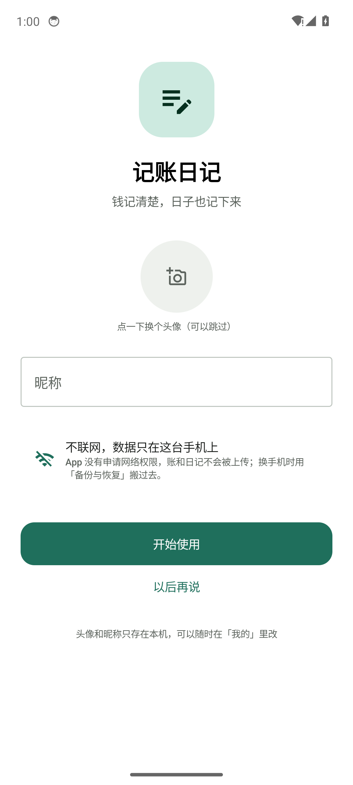 | 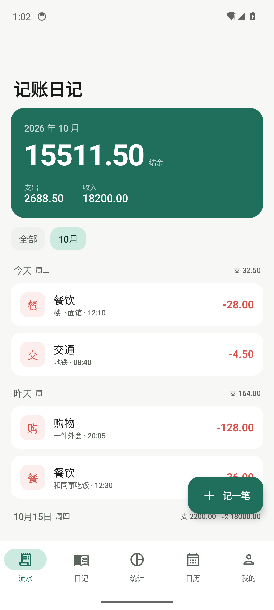 | 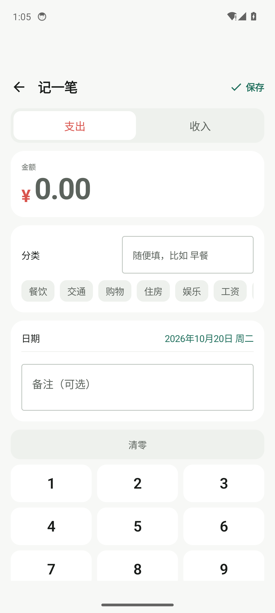 |

| 日记列表（一天多篇） | 编辑某一篇 | 新写一篇 |
|---|---|---|
| 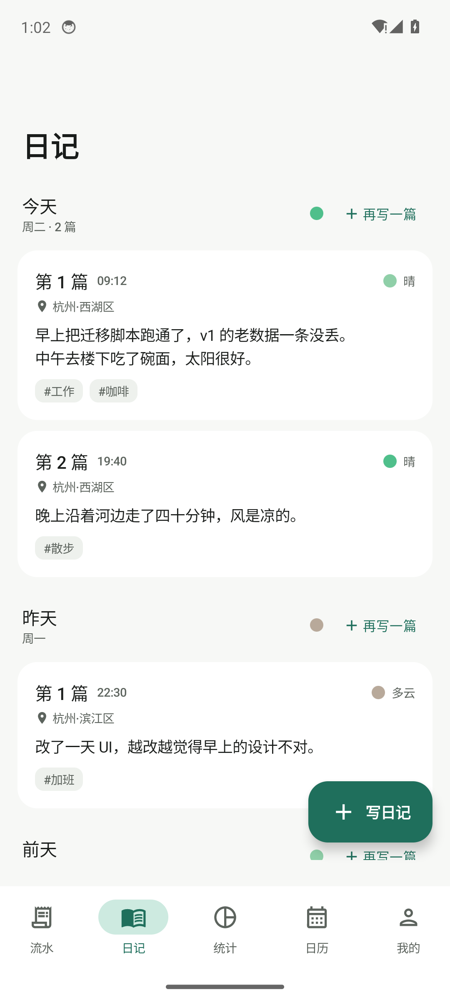 | 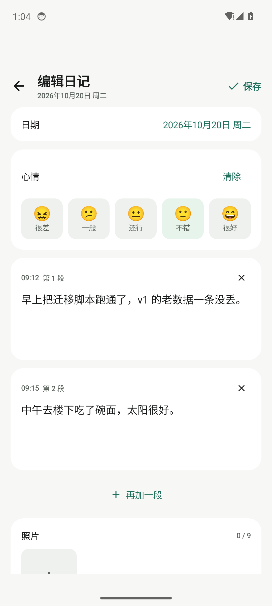 | 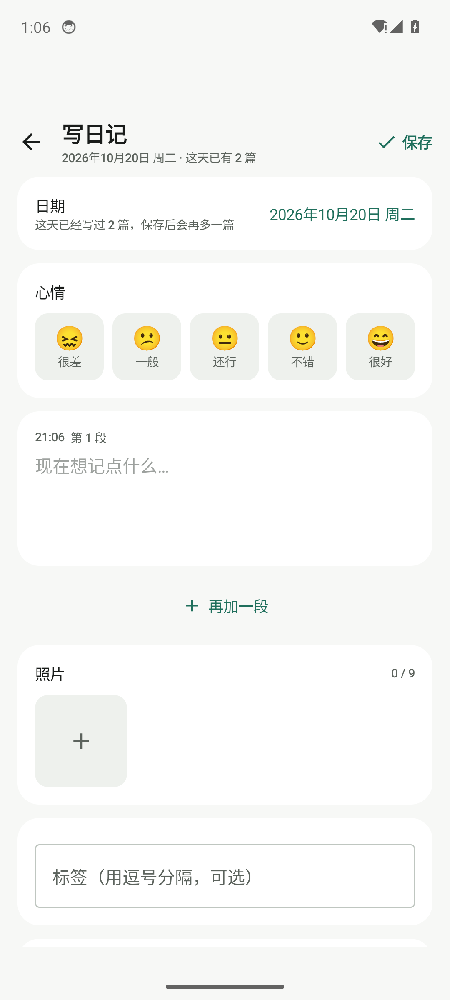 |

| 每篇自己的地址 | 收支总览 | 支出 × 心情 |
|---|---|---|
| 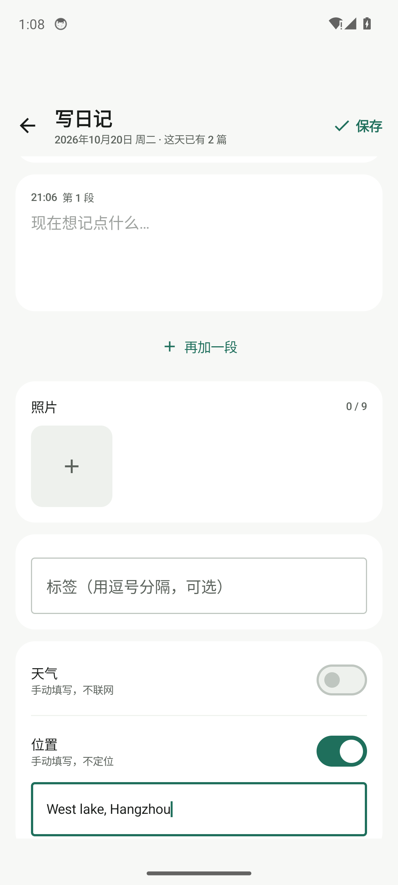 | 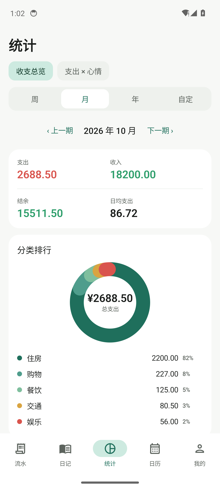 | 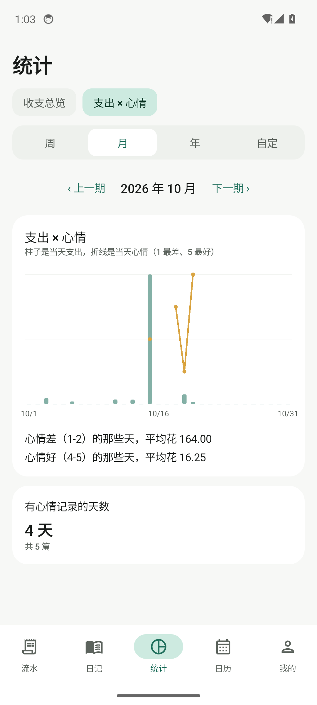 |

| 日历 | 日历 · 当天多篇 | 备份与恢复 | 我的 |
|---|---|---|---|
| 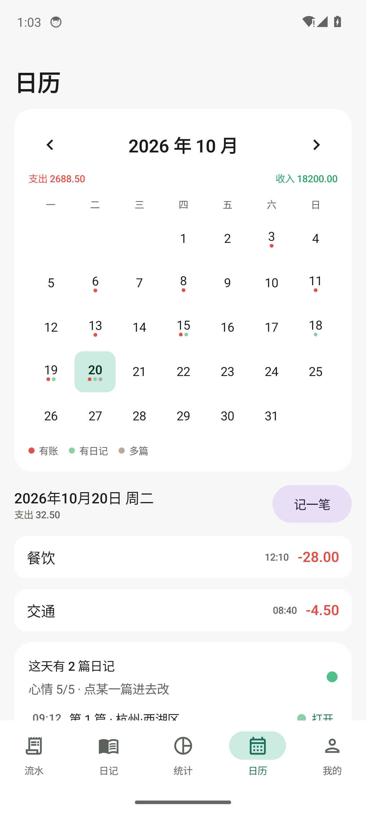 | 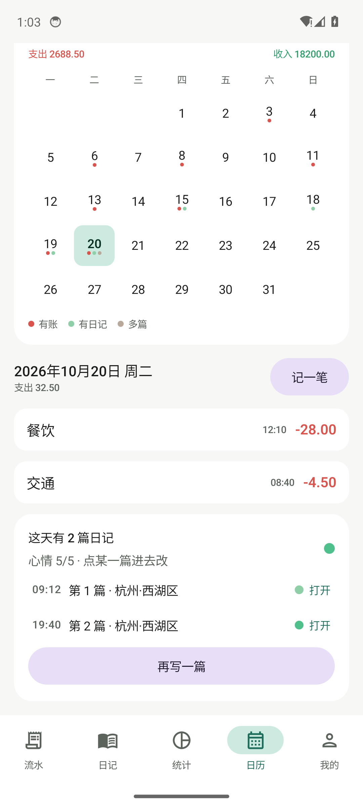 | 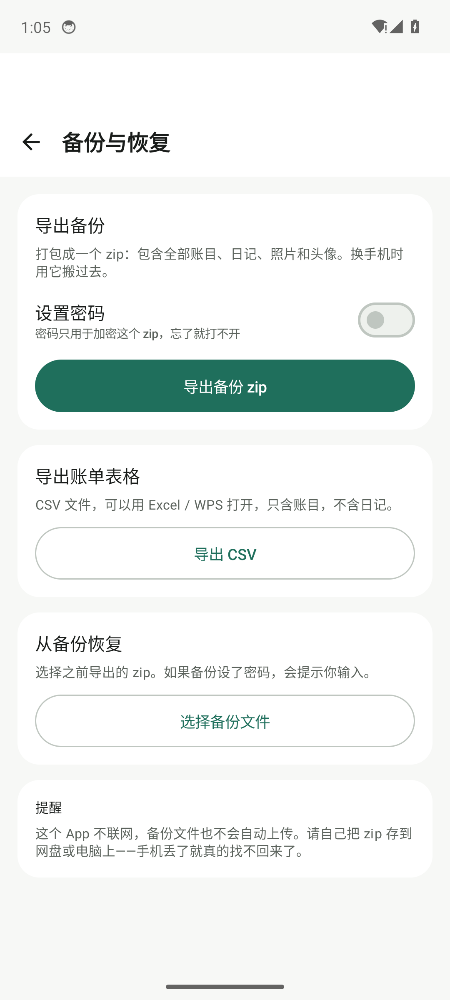 | 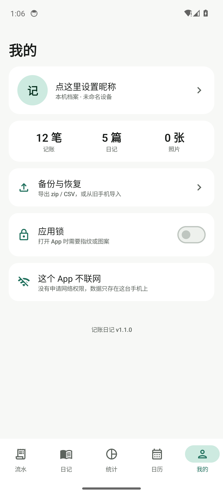 |

> 截图来自 Android 14 x86_64 模拟器（1080×2400，420dpi），用的是演示数据。

---

## 功能

### 流水（记账）

- 支出 / 收入切换，金额用 `Long` 存**分**，全程整数运算，不用 `Double`
- 分类**自由填写**，历史分类会自动变成快捷标签，点一下就能选
- 日期可选（默认今天，不允许选未来），备注可选 —— 只有金额是必填的
- **自绘数字键盘**，不会被输入法顶起来，也不用担心系统键盘弹不出小数点
- 月份筛选（最近 6 个月 + 全部），每天分组显示「支 xx / 收 xx」
- 顶部汇总卡：结余 / 支出 / 收入（结余 = 收入 − 支出，负数才是亏）
- 长按删除 → 底部 5 秒「撤销」条，误删能救回来（软删除，`deletedAt` 打标记）

### 日记

- **一天可以写很多篇**。列表按天分组，天内按写入时间正序排「第 1 篇 / 第 2 篇」，像一条时间线；每天右上角有「再写一篇」
- 每篇的正文还可以分成**多个段落**，每段有自己的时间戳 —— 早上写一段、晚上补一段
- **心情、天气、地址都是「每篇」的**，不是「每天」的：上午在西湖区写了篇「不错」，晚上在滨江区加班写了篇「很差」，两篇各自记录
- **当天心情**由当天各篇派生：取这天最后一篇填了心情的那篇（只写一篇时和 v1.0.0 完全一样）。日历和统计里显示的就是这个值
- 心情 5 档（很差 / 一般 / 还行 / 不错 / 很好），可清除
- 标签用逗号分隔，列表页显示成 `#tag` 小胶囊
- 天气、地址都是**手动填**（不联网、不定位），不需要可以关掉
- 照片最多 9 张：走系统 Photo Picker（只给你选的那几张授权），导入时压到长边 1600px / JPEG 85，并且**按 EXIF 修正旋转**，竖拍照片不会横着躺
- 长按日记卡片删除 → 同样 5 秒撤销，撤销会把整篇（含段落和照片引用）原样写回

### 统计

- 两个 tab：**收支总览** / **支出 × 心情**
- 区间切换：周 / 月 / 年 / 自定（自定可以选任意起止日期）
- 收支总览：支出、收入、结余、日均支出 + 分类排行环形图 + 最近 12 个月柱状图
- 点分类排行里的一行 → 弹出**该分类在当前区间的明细**（只读，要改去流水页点它）
- 支出 × 心情：柱子是当天支出，折线是当天心情，并给出结论文字，例如「心情差（1-2）的那些天，平均花 xx」
- 心情按**天**去重统计：一天写了三篇也只算一天，心情取当天最后一篇填的那个

### 日历

- 月视图，日期上有三个标记：**红点 = 有账**，**绿点 = 有日记**，**第三个点 = 这天不止一篇日记**
- 点某一天，下方列出当天账目，再下面是「这天有 N 篇日记」，逐篇列出「时间 / 第几篇 / 地址 / 打开」
- 「记一笔」直接带着这个日期进入记账页；「再写一篇」直接带着这个日期新建一篇日记
- 日记卡片永远可点：有日记显示「打开」，没日记显示「写」—— 日历是找日子的地方，不该只能看不能进

### 我的

- 昵称 + 头像（头像压到 512px，存本地），设备名只是来源标识，不锁数据
- 三格计数：记账 N 笔 / 日记 N 篇 / 照片 N 张
- 备份与恢复（见下）
- 应用锁开关
- 「这个 App 不联网」说明
- 底部版本号读 `BuildConfig.VERSION_NAME`，不再手写

### 备份与恢复

**导出**

- **zip 备份**：一个文件打包全部账目、分类、日记、段落、照片、头像
- 可选**加密**：AES-256/GCM，密钥由 `PBKDF2WithHmacSHA256(密码, salt, 100000 轮)` 派生，salt 16B / IV 12B
- 默认直接写进系统「下载/记账日记」目录（Android 10+ 走 MediaStore，不需要任何权限）
- 导出后可以「分享」（发微信 / 网盘 / 邮件）或「另存到我选的位置」
- **CSV 导出**：带 UTF-8 BOM，Excel / WPS 打开中文不乱码，只含账目不含日记

**导入**

- 选 zip 后先预览（导出时间、来自设备、账目 N 笔、日记 N 篇、照片 N 张），加密包会要求先输密码
- **合并**：把备份里的记录追加进来，重复 id 的直接跳过，不动现有数据
- **覆盖还原**：先自动把当前数据另存一份（`exportZip(null)`），再清空四张表并删照片目录，然后恢复 —— 选错了还能从自动备份退回来
- 备份格式向后兼容：v1.0.0 导出的包能导进 v1.1.0（`DiaryEntryDto` 字段没变，一天多篇只是多了几行）

### 应用锁

- 用 `BiometricPrompt`，指纹 / 图案 / 密码都行（`BIOMETRIC_WEAK or DEVICE_CREDENTIAL`）
- 冷启动默认锁定，App 真正退到后台（`ProcessLifecycleOwner.ON_STOP`）后重新上锁
- 拉起系统选择器 / 分享面板时**不上锁**（`LockState.beginExternalActivity() / endExternalActivity()` 计数），否则回来会看到锁屏，而且页面已被销毁、写入协程被取消，会留下 0 字节的坏文件
- 手机上没有任何可用验证方式时，会显示「暂时放行」，不会把人永久锁在外面

### 主题

- 主色是克制的墨绿 `#1F6F5C`，支出红 `#D9544D`，收入绿 `#2E9E6B`
- 跟随系统深浅色，两套 Material3 配色 + 自定义 Typography
- 状态栏 / 导航栏透明，edge-to-edge

---

## 技术栈

| 分类 | 选型 |
|---|---|
| 语言 | Kotlin 1.9.24 |
| UI | Jetpack Compose（BOM 2024.06.00）+ Material 3 |
| 导航 | Navigation Compose 2.7.7（单 Activity，路由式） |
| 数据库 | Room 2.6.1 + KSP（`room-compiler`） |
| 异步 | Kotlin Coroutines 1.8.1 + Flow / StateFlow |
| 图片 | Coil Compose 2.6.0 + ExifInterface 1.3.7 |
| 序列化 | Gson 2.10.1（备份包） |
| 生物识别 | androidx.biometric 1.1.0 |
| 构建 | AGP 8.5.2 / Gradle 8.9 / JDK 17 / Compose Compiler 1.5.14 |

依赖刻意保持得很少：没有 Hilt、没有 Retrofit、没有 DataStore、没有分页库。理由是这个 App 的数据量级（个人账本，几千条）根本用不上，多一个依赖就多一份升级负担。

---

## 项目结构

```
ledger-diary/
├── build.gradle.kts              # 根构建脚本（AGP / Kotlin / KSP 版本）
├── settings.gradle.kts           # 仓库配置（google / mavenCentral / 阿里云镜像）
├── gradle.properties
├── gradlew / gradlew.bat         # Gradle wrapper 脚本
├── gradle/wrapper/               # wrapper jar + properties（distributionUrl 指向腾讯云镜像）
├── .gitignore
├── keystore/
│   └── ledger-diary.jks          # 本地自用签名（已在 .gitignore 排除，不会上传）
├── docs/screenshots/             # README 用截图
└── app/
    ├── build.gradle.kts          # 模块配置、签名、依赖
    ├── proguard-rules.pro
    └── src/main/
        ├── AndroidManifest.xml
        ├── res/                  # 主题、图标、file_paths（FileProvider）
        └── java/com/ledgerdiary/app/
            ├── LedgerDiaryApp.kt          # Application，预热数据库和照片目录
            ├── MainActivity.kt            # 唯一的 Activity（FragmentActivity）
            ├── data/                      # 数据层
            │   ├── Entities.kt            # 6 张表的实体定义
            │   ├── Daos.kt                # 4 个 DAO
            │   ├── AppDatabase.kt         # Room 数据库（version 2）+ MIGRATION_1_2
            │   └── Repository.kt          # 唯一的数据入口 + DiaryBundle
            ├── backup/
            │   ├── BackupManager.kt       # 导出 / 预览 / 导入、加解密
            │   └── BackupModels.kt        # 备份包 DTO
            ├── ui/
            │   ├── AppRoot.kt             # 底部 5 个 tab + NavHost
            │   ├── AppViewModel.kt        # 全局唯一的 ViewModel
            │   ├── AppLock.kt             # LockState + 锁屏页
            │   ├── components/            # SurfaceCard / MoneyText / 图表等
            │   ├── screens/               # 10 个页面
            │   └── theme/Theme.kt         # 配色与字体
            └── util/
                ├── Money.kt               # 分 ↔ 字符串、键盘输入拼接
                ├── DateUtils.kt           # 日期格式化、相对时间
                ├── DiaryUtils.kt          # 「天 / 篇」分组、当天心情的取法
                ├── PhotoStore.kt          # 照片导入压缩、EXIF 旋转
                ├── FileSaver.kt           # 存下载目录 / 存到指定 Uri / 分享
                └── AppSettings.kt         # SharedPreferences 开关
```

代码量约 **5,240 行 Kotlin**，30 个文件。

### 架构约定

- **单 Activity + Compose + 单 ViewModel**。数据量小，一个 `AppViewModel` 持有全部 `StateFlow`，页面之间共享同一份数据，不需要在 nav graph 里传参。
- **Repository 是唯一数据入口**，UI 不直接碰 DAO（少数列表页为了少写 join 会查一下 DAO）。
- **路由**：`ledger` / `add?id={id}&date={date}` / `diary` / `diaryEdit?id={id}&date={date}` / `stats` / `calendar` / `me` / `profile` / `backup`。
- **金额永远用 `Long` 存「分」**，展示时才转字符串，避免浮点误差。
- **「天」不是数据行**。`diary_entries` 一行就是一篇日记；「这一天」只是界面上的分组，由 `DiaryUtils.groupByDay()` 现算。这样一天想写几篇都不用改表。

---

## 数据模型

6 张表，Room `version = 2`：

| 表 | 说明 | 主键 |
|---|---|---|
| `transactions` | 账目：方向、金额（分）、分类名、备注、日期、`deletedAt` 软删 | String UUID |
| `categories` | 分类：名称（唯一）、图标、颜色、排序、使用次数 | String UUID |
| `diary_entries` | 日记：**一行 = 一篇**，日期（普通索引，同一天可多行）、心情 0-5、标签、天气、地址 | String UUID |
| `diary_segments` | 日记段落：属于某篇、正文、排序（外键 CASCADE） | String UUID |
| `diary_photos` | 日记照片：属于某篇、文件名（存在 `filesDir/photos/`） | String UUID |
| `profile` | 本机档案：昵称、头像文件名、deviceId、deviceLabel | 固定 `"local"` |

**迁移**：`AppDatabase.MIGRATION_1_2` 只做两件事 —— 删掉 `index_diary_entries_date` 的唯一索引，再按同名建一个普通索引。**不重建表**（重建要整表搬家，低端机上风险更高）。索引名刻意保持不变，Room 启动时的 schema 校验才对得上。

**为后续新增需求留的后路**（写进 `Entities.kt` 注释里的设计原则）：

1. 主键全用 **String UUID**，不用自增 `Long` —— 两台手机的记录合并时不会撞 ID，以后做同步也不用改表。
2. 所有业务表都有 `createdAt` / `updatedAt` —— 以后要做「最近修改」「增量同步」直接可用；「天内第几篇」也是靠 `createdAt` 排出来的，没存冗余序号。
3. 字段尽量宽松，新增字段一律给默认值；升级走 Room `Migration`，**明确不用 `fallbackToDestructiveMigration`**（那会清空用户数据）。
4. 已经预留但还没用的字段：`transactions.accountName`（多账户）、`transactions.deletedAt`（回收站）、`diary_photos.segmentId`（照片挂到某一段）、`categories.direction`（收支独立分类）。

---

## 备份文件格式

zip 包结构：

```
记账日记-备份-yyyyMMdd-HHmm.zip
├── meta.json          # 元信息：是否加密、salt、iv
├── data.json          # 全部文字数据（加密时是密文）
├── photos/<uuid>.jpg  # 日记照片原文件
└── avatar.jpg         # 头像（有的话）
```

`meta.json` 示例（加密）：

```json
{
  "format": "ledger-diary-backup",
  "version": 1,
  "exportedAt": 1792386360861,
  "encrypted": true,
  "salt": "uvQ/Hnk5cgP8XphDIffrMA==",
  "iv": "h2ZSVpNZSC5C3WHc"
}
```

`data.json` 解密后是 `BackupFile` 的 JSON：`transactions` / `categories` / `diaryEntries` / `diarySegments` / `diaryPhotos` / `profile`。其中 `diaryEntries` 是**扁平的一行一篇**，同一天有几篇就有几条记录（没有「天」这一层对象），所以 v1.0.0 的包和 v1.1.0 的包结构完全兼容。

**加密细节**：AES-256/GCM/NoPadding，密钥 = `PBKDF2WithHmacSHA256(密码, salt, 100000 轮, 256 位)`，salt 16 字节、IV 12 字节随机生成，GCM tag 128 位（附在密文尾部）。

> ⚠️ 只有 `data.json` 被加密，**照片文件是明文的**（zip 内文件名结构也不加密）。

---

## 自己编译

### 环境要求

- JDK **17**（项目用 `jvmTarget = 17`）
- Android SDK：platform 34 + build-tools
- Gradle **8.9**（仓库自带 wrapper，不用另外装）

### 准备 SDK 路径

在项目根目录建 `local.properties`（不要提交到 git）：

```properties
sdk.dir=/path/to/Android/Sdk
```

或者设置环境变量 `ANDROID_HOME` / `ANDROID_SDK_ROOT`。

### 构建

```bash
# Linux / macOS
./gradlew assembleDebug assembleRelease

# Windows
gradlew.bat assembleDebug assembleRelease
```

> `gradle/wrapper/gradle-wrapper.properties` 里的 `distributionUrl` 指向腾讯云镜像
> （`https://mirrors.cloud.tencent.com/gradle/gradle-8.9-bin.zip`），因为
> `services.gradle.org` 在部分网络下会超时。如果你在海外或公司内网，把它改回
> `https://services.gradle.org/distributions/gradle-8.9-bin.zip` 即可。

产物：

- `app/build/outputs/apk/debug/app-debug.apk`（约 18 MB，包名带 `.debug` 后缀，和正式版数据不互通）
- `app/build/outputs/apk/release/app-release.apk`（约 11.2 MB，已签名）

### 关于签名（重要）

`app/build.gradle.kts` 里的 `signingConfigs.release` 指向 `keystore/ledger-diary.jks`，密码是**明文硬编码**的，而且 `keystore/` 目录在 `.gitignore` 里被排除了。

这意味着：**从 GitHub clone 下来后，`assembleDebug` 能直接跑，`assembleRelease` 会因为没有 keystore 而失败**。要么只编 debug，要么自己准备签名：

```bash
keytool -genkeypair -v -keystore keystore/my-release.jks \
  -alias myalias -keyalg RSA -keysize 2048 -validity 10000
```

然后把 `app/build.gradle.kts` 里的 `storeFile` / `storePassword` / `keyAlias` / `keyPassword` 改成你自己的（推荐从 `local.properties` 或环境变量读，别硬编码）。

> 密码 `ledgerdiary2026` 只是本地自用，公开仓库里的这个值对任何人都没有意义 —— 对应的 jks 并没有上传。

---

## 安装到手机

**方式一：直接传 APK**

把 `app-release.apk` 发到手机（微信文件传输助手 / 数据线 / 网盘），点开安装。首次需要在系统里允许「安装未知来源应用」。

**方式二：adb**

```bash
adb install -r app-release.apk
```

**升级注意**：v1.0.0 → v1.1.0 可以直接覆盖安装（同一个 keystore 签的名），数据库会自动走 `MIGRATION_1_2`，账目和日记都不会丢。**但不要卸载重装** —— `android:allowBackup="false"`，卸载就是真的删库。

**注意**：`release` 包名是 `com.ledgerdiary.app`，`debug` 包名是 `com.ledgerdiary.app.debug`，两个是**独立的 App**，数据不互通。换包会看到两套数据，不是 bug。

---

## 几个实现上的坑（踩过才知道）

这些注释都留在代码里了，列在这里是因为它们都是真实踩出来的：

1. **SAF 导出会留下 0 字节文件**
   拉起 `CreateDocument` 系统选择器时 App 会退到后台 → `ProcessLifecycleOwner.onStop` 触发上锁 → 回来时整个 Compose 树被锁屏替换、`rememberCoroutineScope` 被取消 → 写入协程还没跑就死了，系统已经建好的文件就停在 0 字节。
   修法：主路径改成**直接写 MediaStore**（不离开 App），并且写入后核对字节数；用户主动「另存到别处」时才走选择器，而且改成**同步写入** + 写完读回来复核。

2. **加密备份恢复时密码正确却报「密码不对」**
   `data.json` 是 AES/GCM 密文，含非法 UTF-8 字节。早期代码写成 `readBytes().toString(Charsets.UTF_8)` 存着、解密时再 `toByteArray()` —— 往返过程中非法字节被替换成 U+FFFD，密文被破坏，`doFinal` 抛 `AEADBadTagException`，被 `catch` 吞掉后表现为「密码错」。
   修法：密文**必须按 `ByteArray` 保存**，只在解密成功之后才转 `String`。

3. **解锁后点「合并/覆盖还原」还提示「这个备份设置了密码」**
   UI 里两个按钮把密码写死传了 `null`。修法：`importZip(uri, importPassword.takeIf { it.isNotEmpty() }, ...)`。

4. **结余符号反了**
   `Money.centsToString(expense - income)` 写反了，收入 2221、支出 23.5 会显示 `-2197.50`。正确的是 `income - expense`。

5. **系统文件选择器顶部筛选条会把 zip 过滤掉**
   `OpenDocument.launch(arrayOf(...))` 传多个 mime 会让选择器出现 Audio / Documents 筛选条，用户点了就看不到 zip。改成只传 `"*/*"`。

6. **`input`/`text` 相关的小坑**（只影响自动化测试）
   `adb shell input text` 输中文会抛 `NullPointerException`；坐标不能靠截图目测，必须用 `uiautomator dump` 拿 `bounds` 再点。

7. **一天多篇不能靠「删掉唯一索引」一句 SQL 了事**（v1.1.0）
   Room 的 schema 校验是按「表 + 索引名 + 是否唯一」逐项对账的。想把 `diary_entries.date` 从唯一索引改成普通索引，必须：① 实体上的 `@Entity(indices = ...)` 改掉；② `@Database(version = 2)`；③ 手写 `Migration(1, 2)` 里 `DROP INDEX IF EXISTS` + `CREATE INDEX IF NOT EXISTS`，而且**索引名要和 Room 生成的名字一模一样**（`index_diary_entries_date`），否则升级后一启动就 `IllegalStateException: Migration didn't properly handle`。
   另外别图省事用 `fallbackToDestructiveMigration()` —— 那会直接把用户的日记清空。

8. **编辑页的 `LaunchedEffect` key 不能只写 `loaded`**（v1.1.0）
   日记编辑页里有「`loaded` 之后如果一段都没有就自动加一段」的逻辑。如果 key 只有 `loaded`，从「今天」切到「另一天（没有日记）」时 key 没变、副作用不重跑，页面就会变成**一个输入框都没有**。key 必须带上日期 / 篇 id。

---

## 已知限制

- **没有云同步**，数据只在本机 + 你手动导出的 zip 里。手机丢了就真的找不回来 —— 所以「备份与恢复」页专门写了提醒。
- **没有多账户**（字段 `accountName` 已预留，UI 未接）。
- **删除照片是物理删除**：在日记编辑页点照片上的 ×，会立刻删掉文件并落盘（防止孤儿文件）。日记删除的 5 秒撤销只覆盖整篇日记，不覆盖这个单独的照片删除动作。
- **没有回收站**：账目是软删除（`deletedAt`），但 UI 只有 5 秒撤销，没有「回收站」页面。
- **加密只保护 `data.json`**，备份包里的照片是明文的。
- **「当天心情」是派生值，不能单独编辑**：一天多篇时它固定取「最后一篇填了心情的」，想改当天心情就去改那一篇。
- **无单元测试 / 无 CI**：目前是靠 Android 14 模拟器人工走查验证的。
- `release` 没开混淆（`isMinifyEnabled = false`），体积还能再压。

---

## 后续可以加什么

按「后路已经留好」的顺序排：

1. **多账户** —— `transactions.accountName` 已存在，加一张 `accounts` 表和切换 UI 即可。
2. **回收站** —— `deletedAt` 已经是软删除，加一个查询 `deletedAt IS NOT NULL` 的页面。
3. **增量备份 / 导入去重** —— 主键是 UUID + 有 `updatedAt`，可以按 id + 时间戳做「只导入更新的」。
4. **日记按标签 / 心情检索** —— 现在标签只是显示，没做筛选。
5. **桌面小组件** —— 「今天花了多少」「今天写日记了吗」。
6. **图表增强** —— 月度对比、分类趋势、预算超支提醒。
7. **深色模式手动切换** —— 现在是跟随系统。
8. **数据加密（SQLCipher）** —— 目前数据库本身是明文的，只有备份可以加密。

---

## 签名与安全说明

这个仓库是个人自用项目，`.gitignore` 里已经排除了 `keystore/`、`*.jks`、`*.keystore`、`local.properties`，**签名文件不会进公开仓库**。

但要注意 `app/build.gradle.kts` 里的 `storePassword` / `keyPassword` 仍是明文（`ledgerdiary2026`）—— 那串密码对应的 jks 并不在仓库里，所以对外没有实际风险，只是提醒你 fork 时别直接沿用这个配置。

**如果你 fork 这个项目并要发布自己的版本，请务必**：

- 重新生成 keystore
- 把密码挪到 `local.properties` / 环境变量 / CI secret，不要硬编码
- 确认 `.gitignore` 仍在排除 `*.jks`、`*.keystore`、`local.properties`

App 本身不联网、不收集任何数据，`AndroidManifest.xml` 里只有两个权限：`USE_BIOMETRIC` 和 `USE_FINGERPRINT`（应用锁用）。

---

## License

个人项目，未指定开源协议。如果要使用请自行判断。
